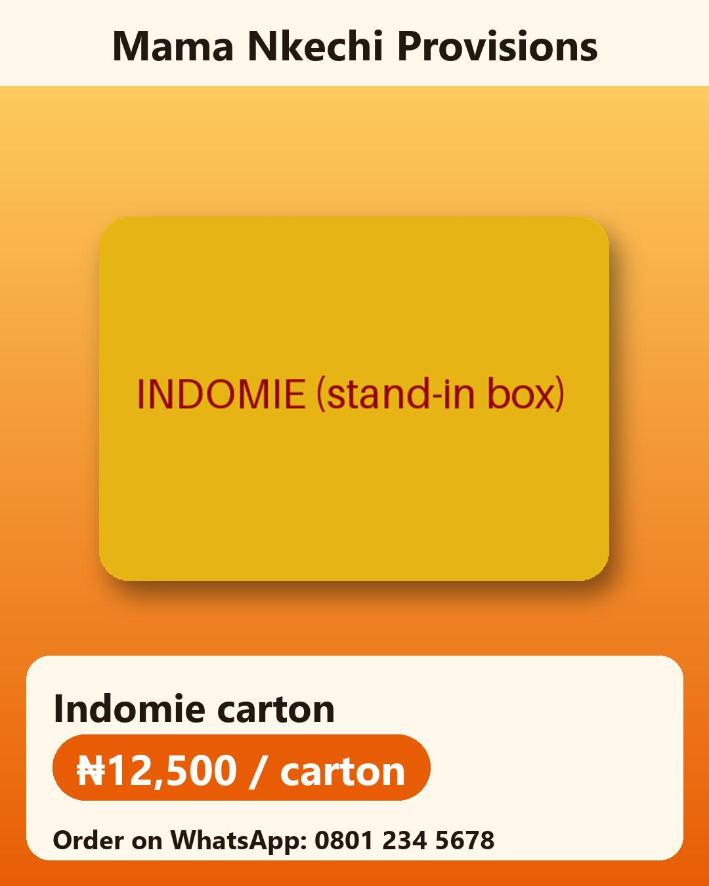

# Sabi

A WhatsApp-native agent that keeps a Nigerian trader's books from the way she already sells: voice notes in Pidgin, photos of receipts, customer DMs. Built for the Meta hackathon, Indie track ("Build for Your World"). All code in this repo was written during the event.

## Design rules (enforced in code, with tests)

1. **The model proposes, code commits.** Muse Spark proposes a business event (`record_entry`). Python builds the journal lines, cost of goods sold and average cost. The model never does accounting arithmetic.
2. **Double entry can't be broken.** Postgres constraint triggers reject any entry whose debits don't equal its credits at commit, and journal lines are append-only (`app/ledger/schema.sql`). The in-memory store enforces the same rules.
3. **Corrections reverse, never edit.** `cancel_entry` posts a mirror-image entry after the owner confirms.
4. **Unclear money always goes to the owner.** The amount normaliser (`app/normalize/amounts.py`) turns "5k" and "1k5" into figures and marks ambiguous ones such as "two-five" (₦2,500 or ₦25,000). Code rejects any proposal that doesn't hand those to the owner as buttons.
5. **Trust is earned per action.** Posting is automatic only when the validator finds nothing: known customer and product, a price within her usual range, enough stock, under the limit. Everything else becomes a WhatsApp button question, answered by code.
6. **Customers are untrusted.** The customer persona has four tools: look up price/in-stock, create an order, claim a payment, see their own orders. It can't reach the ledger, and a transfer screenshot never marks an order paid without the owner.
7. **Every number has a receipt.** Each entry links to its evidence row: the original transcript, the normalised text, the model and the prompt version.

## Layout

```
app/
  ledger/      schema.sql, model, store (memory), validator, posting, reports, seed
  normalize/   amounts.py (Naija money slang), fuzzy.py (product/contact matching)
  agent/       orchestrator, tools, approvals (button answers), orders, prompts/
  models/      llm.py — one client for Muse Spark (Meta API) and Muse Spark Open (Baseten)
  media/       transcribe.py — Muse Voice Transcribe (realtime websocket)
  channels/    whatsapp.py — webhook parsing, signature check, send, media download
  jobs/        daily_summary.py — 8 pm Lagos summary
  main.py      FastAPI app
scripts/chat.py  talk to the agent in a terminal
seed/          chart of accounts, demo shop
tests/         ledger rules, amounts, agent runs with a scripted model, WhatsApp parsing
```

## Run

```
python -m venv .venv
.venv\Scripts\activate
pip install -e ".[dev]"
pytest
```

Copy `.env.example` to `.env` and set `MODEL_API_KEY`. Then:

```
python scripts/chat.py          # be the owner
python scripts/chat.py --customer
uvicorn app.main:app --port 8000
```

For WhatsApp, expose port 8000 (Cloudflare Tunnel), set the callback to `/webhook/whatsapp`, and fill in the `WA_*`, `META_APP_SECRET` and `OWNER_PHONE` settings.

## Photos

- **Receipts and notebook pages** (`app/media/documents.py`): Muse Spark reads the photo into fixed JSON, and code checks every line and the total. If the numbers don't agree, the owner is asked and nothing is recorded until she answers. Clean lines go to her as one summary with a single Confirm. A line with a problem, such as an odd price, is asked about on its own.
- **Stock-take** (`app/agent/stocktake.py`): SAM 3.1 counts each countable product in a shelf photo, and code compares the counts with the books. A gap gets three buttons: *Sold, not recorded* / *Damaged or lost* / *Recount*. Her answer becomes a normal entry, with the shelf photo as its evidence. Products not in the photo are skipped, not flagged. Set `STOCKTAKE_BACKEND=vision` to count with Muse Spark instead.

## Promotion loop (`app/promo/`)

Sell → record → learn from the books → promote → sell.

1. **Code picks the product** (`ranking.py`). It looks for plenty of stock (weeks of cover at the usual sales rate), a good margin, and slower sales than usual this week. Anything at or below its reorder level is never promoted. The reason comes straight from the books, e.g. "44 tin in stock, about 44 weeks' worth, sold 4 this week vs 1.0 usual, 17% margin (₦120 per tin)".
2. **SAM 3.1 cuts out her real product** from a shelf photo (`cutout.py`). It accepts a PNG mask, a polygon or a box. If SAM fails, it falls back to a crop of her photo. The product is never redrawn by AI, which avoids fake-looking packaging and trademark trouble.
3. **Muse Image makes an empty background**, with no products, logos or text (`imagegen.py`).
4. **Pillow builds the flyer** (`compose.py`): 1080×1350 portrait for Instagram. The shop name, product, price and how to order are all drawn by code from the books. It uses a font that has the ₦ sign and falls back to "N12,500" rather than draw a broken box.
5. **Muse Spark writes the caption** in her voice (`caption.py`). Code rejects any caption with a price other than the list price, asks once for a rewrite, then uses a safe template.
6. **She sees the preview on WhatsApp** (image + **Post / Change / Skip**). Nothing goes public until she taps Post. *Change* takes her words ("more Pidgin", "different background") and redrafts.
7. **Publish** (`publish.py`): Instagram content publishing (create the container, then publish), plus the linked Facebook Page if `FB_PAGE_ID` is set. Every post is stored with its reason, caption, the tools that made it, and the platform post ids.



Flyers are served from `/media/` and need a public `PUBLIC_BASE_URL` (tunnel or deployment) so Instagram can fetch them. On Linux, install `fonts-dejavu` or set `FLYER_FONT` so the ₦ sign renders.

## Payment reminders (`app/agent/reminders.py`)

- **Ways to start one**: tap **Send reminders** in the 8 pm summary (drafts for the three most overdue customers), or say "remind Mama Tunde" (`send_reminder`). Every reminder is a preview with **Send / Change / Skip**. Nothing reaches a customer until she taps Send.
- **WhatsApp's 24-hour rule**: if the customer messaged in the last 24 hours, Muse Spark drafts a warm reminder in her voice, and she can tap *Change* ("softer", "in Pidgin"). Otherwise WhatsApp only delivers an approved template. She then sees exactly the template wording with the name and amount filled in, and *Change* isn't offered.
- **Amounts come from the books**: a draft that mentions any other amount is rewritten once, then replaced by a fixed polite wording. On Send, the balance is checked again. If the customer paid in the meantime, nothing goes out.
- **No spamming**: never twice in a day. The 8 pm button skips anyone reminded in the last 3 days. It also names customers with no WhatsApp number, and she can give Sabi a number in chat (`set_contact_phone`). Numbers like 0803… are saved as 234803….
- **Template setup (once)**: `python scripts/create_reminder_template.py` prints the request; add `--submit` with `WABA_ID` and `WA_ACCESS_TOKEN` to send it to Meta for approval.

## Try it: the public demo (`/demo/`, `app/demo.py`)

WhatsApp test numbers only reach a few verified phones, so anyone (judges included) can try Sabi in the browser instead. The page shows two WhatsApp-style phones and the live books:

- **Owner phone**: type, send a photo (receipt, notebook page, shelf), or record a voice note. Tap the buttons Sabi sends back. The **🌙 8 pm summary** button sends the evening summary on demand.
- **Mama Tunde's phone**: a regular customer who owes money. Ask for prices, order, send a "transfer screenshot", receive reminders.
- **The books**: today's sales and profit, cash and bank, latest entries, who owes, and stock. All of it updates as you chat.

It runs the same agent, validator, ledger and approvals as WhatsApp. Each visitor gets a private copy of the demo shop, with a week of history. Nothing reaches a real shop, WhatsApp number or Instagram account: posts are recorded, never published. Limits keep the model bill bounded: 40 messages per visitor, 2,000 a day overall, 200 live sessions, and sessions expire after 2 hours (all set in `.env`). With no model key, it says so and still handles buttons and typed answers.

## Owner app (`web/`, API in `app/api.py`)

A phone-first web app served at `/app/`. It installs to the home screen and shows the last-loaded data when offline. It is plain HTML, CSS and JS with no build step, and it only reads; changes happen on WhatsApp.

- **Today**: sales and profit (today and this week), cash and bank, who owes, low stock, latest entries, and how many questions are waiting on WhatsApp.
- **Ledger**: every entry, newest first, grouped by day, with filters. Cancelled entries are struck through and linked to their cancellation.
- **Evidence viewer**: tap any entry to see where it came from. That includes her exact words (and the voice note or photo itself), how the amounts were read, what Sabi extracted, the model and prompt version, whether it was automatic or she confirmed it, and the balanced double entry.
- **Owing**: total owed and each customer, with days late. Tap a customer for their statement with a running balance.
- **Profit**: P&L for today, this week, this month or all time, plus where each ₦100 of sales went.
- **Posts**: every flyer with its caption, why the books picked that product, and its status.

Every `/api` route needs `OWNER_APP_TOKEN` as a Bearer header. The app asks for the key once, or takes it from a link like `/app/#key=…` and clears it from the address bar. With no token set, only this machine can connect. Voice notes, photos and flyers are served only through the authenticated API, never at public links.

Try it with a week of demo trading:

```
python scripts/dev_server.py      # then open http://127.0.0.1:8000/app/
```

## Storage

`STORE=memory` (default) or `STORE=postgres` with `DATABASE_URL` (Supabase). The Postgres store applies `schema.sql` on start and loads the demo shop into an empty database. Tests run every ledger and agent case on both stores, using an embedded Postgres (`pgserver`), so the triggers are exercised for real.

## Status

Working and tested (185 tests), with the owner app also checked by hand at phone size in light and dark mode: the ledger and its database triggers, the Postgres and memory stores, the validator, posting and reversals, the amount normaliser, the agent with both personas, owner approvals, customer orders and payment claims, receipts and notebook pages, the stock-take, the promotion loop, payment reminders, the public two-phone demo, WhatsApp parsing and sending, and the daily summary.

Not yet verified against the live APIs: the Muse Voice Transcribe request format, image input to Muse Spark, the SAM 3.1 endpoint and response, the Muse Image request, tool calling on Baseten, a real Instagram post, and the reminder template (it needs Meta's approval).
