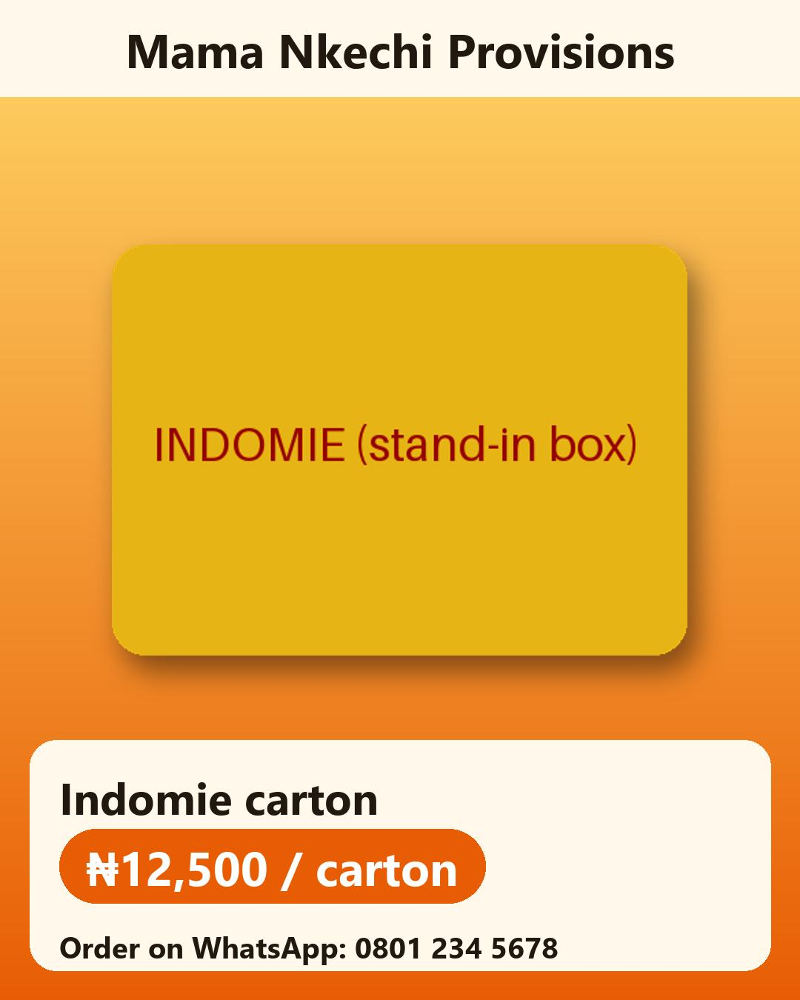

# Sabi

A WhatsApp-native agent that keeps a Nigerian trader's books from the way she already sells: voice notes in Pidgin, photos of receipts, customer DMs. Built for the Meta hackathon, Indie track ("Build for Your World"). All code in this repo was written during the event.

## Design rules (enforced in code, with tests)

1. **The model proposes, code commits.** Muse Spark proposes a business event (`record_entry`). Python builds the journal lines, cost of goods sold and average cost. The model never does accounting arithmetic.
2. **Double entry can't be broken.** Postgres constraint triggers reject any entry whose debits don't equal its credits at commit, and journal lines are append-only (`app/ledger/schema.sql`). The in-memory store enforces the same rules.
3. **Corrections reverse, never edit.** `cancel_entry` posts a mirror-image entry after the owner confirms.
4. **Unclear money always goes to the owner.** The amount normaliser (`app/normalize/amounts.py`) turns "5k" and "1k5" into figures and marks ambiguous ones such as "two-five" (₦2,500 or ₦25,000). Code rejects any proposal that doesn't hand those to the owner as buttons.
   Money paid out of an empty till is also unclear: if a purchase, bill or withdrawal would take cash or the bank below what the books show, she is asked first (*Yes, record it* / *Paid from cash* / *Cancel*).
5. **Trust is earned per action.** Posting is automatic only when the validator finds nothing: known customer and product, a price within her usual range, enough stock, under the limit. Everything else becomes a WhatsApp button question, answered by code.
6. **Customers are untrusted.** The customer persona has four tools: look up price/in-stock, create an order, claim a payment, see their own orders. It can't reach the ledger, and a transfer screenshot never marks an order paid without the owner.
7. **Every number has a receipt.** Each entry links to its evidence row: the original transcript, the normalised text, the model and the prompt version.

## Layout

```
app/
  ledger/      schema.sql, model, store (memory), validator, posting, reports, seed
  normalize/   amounts.py (Naija money slang), fuzzy.py (product/contact matching)
  agent/       orchestrator, tools, approvals (button answers), orders, sales (leads, handoff, follow-ups), knowledge (shop info from her pages), alerts (restock), onboarding (photo to products), prompts/
  models/      llm.py — one client for Muse Spark (Meta API) and Muse Spark Open (Baseten, Fireworks)
  media/       transcribe.py — Muse Spark Open hears voice notes on Baseten; or Muse Voice Transcribe, or Whisper on Fireworks
  channels/    whatsapp.py — webhook parsing, signature check, send, media download
  jobs/        daily_summary.py — 8 pm Lagos summary
  main.py      FastAPI app
scripts/chat.py  talk to the agent in a terminal
seed/          chart of accounts, demo shop
tests/         ledger rules, amounts, agent runs with a scripted model, WhatsApp parsing
```

## Run

```
python -m venv .venv
.venv\Scripts\activate
pip install -e ".[dev]"
pytest
```

Copy `.env.example` to `.env` and set `MODEL_API_KEY`. Without a Meta key, set `LLM_BACKEND=baseten` and `BASETEN_API_KEY` instead: the agent then runs on Muse Spark Open (`meta-models/muse-spark-open-1026`), which calls tools, reads photos and hears voice notes itself. A WhatsApp voice note (OGG/Opus) goes into the chat request as it is; the demo page's WebM recordings are converted with ffmpeg first. Shelf photos are then counted by Muse Spark Open, and flyers use a plain gradient background in place of Muse Image. `LLM_BACKEND=fireworks` with `FIREWORKS_API_KEY` also works, but Fireworks has no speech model on serverless, so voice notes there need the Meta key; without one, Sabi asks people to type and the demo hides its microphone. `python scripts/check_models.py` tries a tool call, a photo and a voice note against whatever is configured. Then:

```
python scripts/chat.py          # be the owner
python scripts/chat.py --customer
uvicorn app.main:app --port 8000
```

For WhatsApp, expose port 8000 (Cloudflare Tunnel), set the callback to `/webhook/whatsapp`, and fill in the `WA_*`, `META_APP_SECRET` and `OWNER_PHONE` settings.

To host it for free, always on: Render (`Dockerfile`, `render.yaml`) with the books in Supabase. Step by step in [docs/hosting.md](docs/hosting.md).

## Photos

- **Receipts and notebook pages** (`app/media/documents.py`): Muse Spark reads the photo into fixed JSON, and code checks every line and the total. If the numbers don't agree, the owner is asked and nothing is recorded until she answers. Clean lines go to her as one summary with a single Confirm. A line with a problem, such as an odd price, is asked about on its own.
- **Stock-take** (`app/agent/stocktake.py`): SAM 3.1 counts each countable product in a shelf photo, and code compares the counts with the books. A gap gets three buttons: *Sold, not recorded* / *Damaged or lost* / *Recount*. Her answer becomes a normal entry, with the shelf photo as its evidence. Products not in the photo are skipped, not flagged. Set `STOCKTAKE_BACKEND=vision` to count with Muse Spark instead.

## Promotion loop (`app/promo/`)

Sell → record → learn from the books → promote → sell.

1. **Code picks the product** (`ranking.py`). It looks for plenty of stock (weeks of cover at the usual sales rate), a good margin, and slower sales than usual this week. Anything at or below its reorder level is never promoted. The reason comes straight from the books, e.g. "44 tin in stock, about 44 weeks' worth, sold 4 this week vs 1.0 usual, 17% margin (₦120 per tin)".
2. **SAM 3.1 cuts out her real product** from a shelf photo (`cutout.py`), using SAM's own mask decoded with Meta's `meta-sam-parser`; a box or a crop of her photo if that fails. The product is never redrawn by AI, which avoids fake-looking packaging and trademark trouble.
3. **Muse Image makes an empty background**, with no products, logos or text (`imagegen.py`).
4. **Pillow builds the flyer** (`compose.py`): 1080×1350 portrait for Instagram. The shop name, product, price and how to order are all drawn by code from the books. It uses a font that has the ₦ sign and falls back to "N12,500" rather than draw a broken box.
5. **Muse Spark writes the caption** in her voice (`caption.py`). Code rejects any caption with a price other than the list price, asks once for a rewrite, then uses a safe template.
6. **She sees the preview on WhatsApp** (image + **Post / Change / Skip**). Nothing goes public until she taps Post. *Change* takes her words ("more Pidgin", "different background") and redrafts.
7. **Publish** (`publish.py`): Instagram content publishing (create the container, then publish), plus the linked Facebook Page if `FB_PAGE_ID` is set. Every post is stored with its reason, caption, the tools that made it, and the platform post ids.
8. **WhatsApp** (`share.py`): after Post, she chooses with buttons. *My Status* sends her the flyer to forward to her Status, since the API can't post there. *Recent customers* goes to people who messaged in the last 24 hours. *Offer list* goes to customers who said yes to offers, using the approved `new_arrival` template outside the 24-hour window. She sees who will get it and taps Send first. STOP from a customer takes them off the list, without the model. Setup: [docs/social.md](docs/social.md).



Flyers are served from `/media/` and need a public `PUBLIC_BASE_URL` (tunnel or deployment) so Instagram can fetch them. On Linux, install `fonts-dejavu` or set `FLYER_FONT` so the ₦ sign renders.

## Pilot with real traders (`app/shops.py`, `app/pilot.py`)

For testing with real traders before WhatsApp is connected. Turn it on with `SHOPS_DB`, and see [docs/pilot_guide.md](docs/pilot_guide.md) for running the pilot day.

- **Separate books:** each tester's books live in their own Postgres schema, with the same tables and triggers as the main shop. `SHOPS_DB=pgserver:<folder>` runs an embedded Postgres kept in that folder.
- **Owner app:** gets a **Chat** tab, with text, voice notes, photos and button approvals, plus a welcome page about her data and **Delete my shop**.
- **Customer chat link:** each shop has one (`/c/<shop>`). Customers get prices, orders and payment claims there, and can be handed to the owner, exactly as on WhatsApp.
- **New shops start empty:** she can add products by typing them (`add_products`) or from a photo. A product whose stock was never recorded still sells, without stock questions.
- **Admin page:** at `/admin/` (key: `ADMIN_TOKEN`). It creates shops, sends each tester her private app link, and shows each shop's messages, entries, reply times, errors and feedback, with full transcripts.
- **Public results page:** `/results` shows the pilot's totals (shops, messages, voice notes, entries, customers, orders, sales, median reply time, error rate, thumbs down) with no names or chats. A tester's words appear only after the admin ticks "show on results".

## How accurate is it? (`scripts/benchmark.py`)

64 trader messages (English, Pidgin, Yoruba, Hausa, French, Portuguese, Swahili) in `tests/bench/cases.json`, each with the entries it should produce, run against the real model. A message passes only if every field of every entry is right, and, for the other languages, if Sabi replied in that language. Latest: 63 of 64 fully right (98%), all 12 French, Portuguese and Swahili messages right, median reply 5.3 s. The latest run is in [docs/benchmark.md](docs/benchmark.md). It already found one fix: "sold 2 rice cash" left the paid amount empty, so code now reads cash or transfer with no amount as paid in full.

## Her settings, her coach, her score

- **Summary when she wants it** (`app/prefs.py`): every day, once a week, or off, at the hour she picks (5 am to 11 pm), on the day she picks. She sets it in **Shop ⚙ → Settings** or just tells Sabi ("send my summary Saturday 9am"). Also there: how reminders sound (gentle, firm, Pidgin), savings, low-data mode, and what she shares.
- **Weekly summary:** the week's sales against the week before, best sellers, everyone who owes, what to restock, what Sabi did for her, and up to three tips.
- **While you worked:** the summary counts the orders Sabi took from customers and their value, not just the messages.
- **Coach** (`app/ledger/coach.py`): tips computed from her books, never by the AI: selling below cost, a supplier price that went up, thin margins (with a price that gives 20%), stock that hasn't sold in 14 days, products whose cost she never gave, her best earner. A price tip is remembered; once she changes the price, the next summary says what happened since.
- **Why is this in my books?** (`app/ledger/explain.py`): tapping any entry shows what she sent, which amounts code read, what the AI proposed, every check code ran, and who let it in (auto-recorded under her limit, or she tapped Confirm).
- **Sabi Score** (`app/ledger/score.py`): 0 to 100 from her own records: keeping records (25%), steady sales (20%), profit (20%), collecting credit (15%), proof behind entries (10%), growth (10%). Each part shows what it measured, and she gets the one step that would raise it most. No score before 14 days and 10 entries. It shows on her statement only if she allows it.
- **Payment alert check** (`app/agent/payments.py`): she forwards a bank SMS or a transfer screenshot. The model reads a screenshot; code reads an SMS and makes every check: still pending, wrong date, the sender's receipt rather than her bank's alert, a missing balance line, a different account from her payment details, a wrong amount, or a different name. It is matched to open orders and debts, and always ends: "Only your own bank app or balance proves the money arrived." A customer's screenshot sent as proof of payment gets the same check before the owner is asked.
- **Savings and ajo:** "I put 5k for ajo" is a `saving` entry (to a Savings asset account, so it's still her money). If she sets a percentage, the summary says how much to put aside from today's profit, and progress to her goal.
- **Reminders in her tone,** with her payment details added by code after the wording check.
- **Shared supplier prices** (`app/market.py`, pilot shops): opt-in and anonymous. She sees the lowest, middle and highest price other Sabi shops paid for the same product (same name and unit), and how many are restocking it, only when at least two other shops share.
- **In the app:** 🔊 reads any reply aloud with the phone's own voice. **Share to Status / Instagram** sends a flyer with its caption. **Low-data mode** loads photos only when tapped and checks for messages less often. **Notifications** (pilot shops, Web Push): her phone is told when a customer needs her or her summary is ready, even with Sabi closed.

## A statement she can take to a lender (`app/ledger/statement.py`)

Most Nigerian traders can't get a loan because they have no records. Sabi has been keeping them all along.

- She says "I wan apply for loan" (`business_statement`), or opens **Profit → Business statement** in the owner app, and gets a one-page statement.
- **What it covers:**
  - sales, gross profit and margin, and net profit, month by month
  - average weekly sales, and the number of days she traded
  - cash, bank, stock at cost, what customers owe her and what she owes suppliers
  - credit sold and how much was collected
  - best sellers
- **How the figures were kept:** how many entries there are, how many have their original voice note, message or receipt attached, and how many mistakes were corrected by a visible reversal.
- **Plain summary and score:** two or three sentences on the shop's sales, profit, margin and collection, and the Sabi Score with its parts, if she shares it.
- **What it doesn't claim:** it says plainly that these are her own records, not audited accounts. Under two months of records, it says lenders usually want three.
- **Sharing:** she shares it with a signed link that expires after 7 days (`/s/<token>`; signed with `STATEMENT_SECRET`, or `OWNER_APP_TOKEN` if that isn't set), or prints it to PDF. The page loads nothing from outside.

## Sabi speaks first (`app/agent/alerts.py`, `app/ledger/validator.py`)

- **Credit guard:** before a credit sale is recorded, code checks how that customer has paid before (oldest debt paid first), and asks first if any of these is true:
  - she already owes and is late
  - the new total would pass ₦100,000
  - she has paid at least two debts late, by 3 or more days on average

  The owner sees for example "⚠️ Before you give credit: Mama Tunde already owes ₦54,000, 2 days late. Still give ₦25,000 on credit?", with **Yes, give credit / Paid cash now / Cancel**. Good payers go straight through.
- **Restock alerts:** after a sale leaves a product at its reorder level, or with 3 days or less to go at the recent pace, Sabi tells her:
  - how many are left
  - how many days that lasts at her pace
  - who she last bought from, and the price
  - how many to order for about a week

  **Draft order** writes the message for her supplier. She gets at most one alert per product a day. "Wetin I suppose buy?" gets the same advice (the `restock` report).
- **In the 8 pm summary:**
  - what to restock
  - what customers keep asking for that she doesn't sell ("3 customers asked for Golden Morn this week. Worth stocking?")
  - what Sabi did today, with a rough time saved (about 2 minutes per entry and per customer reply)

## Setting up from a photo (`app/agent/onboarding.py`)

She photographs her price list or stock notebook and says "set up my shop" (`setup_from_photo`).

- **Reading it:** Muse Spark Open reads every line: name, unit, price, and where shown, the count and what she paid.
- **Matching:** code compares each line with her existing products. A known product at a new price becomes a price change, not a duplicate.
- **Approval:** she sees the whole list (➕ new, ✏️ price changes) and taps **Add all**.
- **Opening stock:** recorded only where the page gives both a count and a cost. A count without a cost would make her profit wrong, so she's told instead.

**Languages** (`app/agent/language.py`): the owner and her customers can write or speak in any language: English, Pidgin, Yoruba, Igbo, Hausa, French, Portuguese, Swahili, Arabic and more. Sabi replies in the language of each message.
- **Code-written messages too:** confirmations, questions with buttons, summaries and tips are written by code in English, then translated in one model call. Code checks every number in the translation against the English; if one is missing or changed, that message goes out in English. A translation can make a sentence clumsy, but it can never change an amount. Button ids never change, so a tap in any language settles the same thing.
- **Her language:** set in **Shop ⚙ → Settings**, or by telling Sabi ("parle-moi en français"). On "auto" Sabi follows what she writes. Traders writing Pidgin or a Nigerian language keep English for code-written text, which they read every day, unless they choose otherwise.
- **Amounts written the French way** are read by code: "12 500 F", "15 000 francs", "78.000", "2 mille", "1,5k", Portuguese "15 mil", Swahili "elfu 5". "3 500" with no money word next to it could be 3 items at 500, so it is left for the model and the price check.
- Reminders and captions are drafted in her language, and 🔊 reads replies with the phone's voice for that language when it has one.
- **Her money** (`app/money.py`): naira, F CFA (West and Central Africa), cedi, Kenyan, Tanzanian and Ugandan shilling, or rand, set in **Shop ⚙ → Settings** or by telling Sabi ("je suis au Sénégal, mes comptes sont en francs CFA"). Every message, summary, caption, statement and screen writes amounts her way (₦12,500 or 12 500 F CFA), and code reads amounts the way she writes them ("15 000 F", "GH₵450", "300 cedis"). A naira shop never reads "$20" as naira. Nothing is converted between currencies: the setting is the money her books are kept in.

## The demo bookshop (`app/agent/books.py`, `seed/bookshop.json`)

The demo shop is Nkechi Books & Stationery in Ogba, Lagos (`DEMO_SHOP=bookshop`; `DEMO_SHOP=provisions` brings back the provisions shop). It has school textbooks from Primary 4 to SS2, literature texts, exam past questions, children's books, a Bible, a dictionary and stationery. Its history includes the September resumption rush and a normal week. Every book knows its title, author, publisher, edition, class and subject (`Product.details`).

- **A booklist from a photo**: a parent sends a photo of the school list. Muse Spark reads every line, and code matches each one to the shelf at the right class and edition. Short forms are understood ("Basic Sci. & Tech. JSS 1", "NGM", "Basic 7" for JSS1, "2 dozen" exercise books). Code prices the list from the books and says what is ready, short, sold out or not stocked. One reply gives the total for what the shop has, and "reserve them" turns it into an order. The model never prices a line.
- **School lists the shop keeps**: the owner sends a nearby school's list once ("this is Grace College JSS1 list", `save_booklist`). After that, a parent only says "my son is in JSS1 at Grace College".
- **Classes and editions**: JSS1 maths is never offered as JSS2 maths. An old edition points to the newer one, and a list that asks for a particular year gets that edition, or a note to check with the school.
- **A book from its cover**: the owner sends a cover photo with "I sold 2 of this one", or a customer sends one asking "do you have this?", and Sabi finds the book.
- **Before resumption** (`term_restock`): Sabi works out when schools next resume (usually mid-September, mid-January and late April). For each title it counts what she sold in the last resumption rush, adds what parents asked for that she didn't have, and gives the order quantity and an order-by date three weeks ahead. It also lists old-edition copies to clear rather than reorder. The second- and third-term shares of a September rush are stated as assumptions.
- What parents asked for and couldn't get goes into her summary as before ("Agricultural Science JSS1 ×3").

## Selling to customers (`app/agent/sales.py`, `orders.py`)

Customers message the shop's WhatsApp number, and Sabi answers straight away, in their language, with the shop's real prices and stock. Nobody waits for the owner to see the message before getting a reply.

- **Answers and sells**: prices and stock come only from the books. Hours, location and delivery come from the shop info (`shop_info`). It takes the order at list price, holds the stock for 24 hours, and gives a short order ref and the payment details. A transfer screenshot never marks an order paid: the owner confirms she saw the alert.
- **Every chat is a lead, kept by code**: what they asked about, then ordered, paid, or lost when the order expired unpaid. Sabi also notes what they wanted that the shop doesn't sell or has run out of ("Golden Morn ×3"). The model never decides any of this. Code records it from the tool calls.
- **Hands off to the owner**: on haggling, bulk buying, complaints, or anything not in the shop info, Sabi calls `hand_to_owner`. The owner gets the reason and a summary with **Reply / Let Sabi handle it**. Until she hands the chat back, Sabi doesn't answer that customer and passes each message on to her. She taps Reply, types, and Sabi sends her words from the shop's number. What she said is kept, so Sabi stays consistent with it afterwards.
- **One follow-up, never spam**: 3 hours after a customer goes quiet, Sabi sends one nudge. An unpaid order gets "still set aside for you", with the payment details. A question without an order gets "still interested in the …? We have it". It only goes out inside WhatsApp's 24-hour window, never while the owner has the chat, and never twice for the same deal.
- **Shopping by picture** (`app/agent/product_photos.py`): a customer sends a photo of what they want. Muse Spark is shown the photo with the shop's product list and says which product it is; code keeps only a real product id and takes stock and price from the books. In stock: the shop's own picture of it goes back with the price, and the chat carries on to an order. Not sold, or out of stock: Sabi says so, offers similar products that are in stock (with their pictures), and notes the request, so it shows in her summary under "Asked for but not available". When her list doesn't name the brand ("Spaghetti pack" for a photo of Golden Penny), Sabi shows hers by her name for it and never promises the brand. She gives a product its picture by sending a photo ("this is my Peak milk"); a flyer made from her photo does it too.
- **The owner sees the pipeline**: the 8 pm summary adds customer chats, orders, payments, who is waiting for her, and what people asked for that she lacks. She can also ask "how my customers do today?" (the `sales` report), and the owner app has a **Sales** tab for it (`GET /api/sales`).

## What Sabi knows about the shop (`app/agent/knowledge.py`)

The sales assistant is only as good as what it knows. There are three ways to load it, and the owner approves what customers will be told every time:

- **From her own pages**: she sends her website, Instagram or Facebook link on WhatsApp, or opens ⚙ in the owner app and taps *Read my pages*.
  - The website is read directly: the home page plus up to four useful pages (about, contact, delivery, FAQ, products).
  - Instagram uses the Graph API's `business_discovery` (bio, website, recent captions) when `PAGE_ACCESS_TOKEN` and `IG_USER_ID` are set.
  - The Facebook Page uses the Graph API (about, hours, address, phone, recent posts).
  - The WhatsApp business profile comes from the Cloud API once WhatsApp is connected.
  - Without a token, Instagram and Facebook fall back to the public preview, and Sabi says plainly when a page needs a sign-in.
  - Muse Spark Open drafts the shop info: address, hours, delivery, payment, returns and bulk terms. It also lists what customers often ask that her pages don't answer, and products on her pages that aren't in the books. She gets **Use this / Change / Skip**.
- **By telling Sabi**: "we now close 8pm on Saturday" → `update_shop_info` drafts the new text, and she approves it.
- **From a file**: copy `seed/my_shop.example.json` (business info, links, products, contacts, opening stock) and start with `SHOP_FILE=your_shop.json`.

**What customers get:**
- The approved shop info goes into every customer prompt, which keeps replies fast.
- The pages themselves are kept, so `shop_details` can look up something specific, such as bulk discounts or delivery to Ikeja, without loading every page into every message.

**Safety:**
- Only the owner can make Sabi read a link.
- Only public web addresses are fetched, and every redirect is checked, so a link can't reach the server's own network.
- Page text is treated as information, never as instructions.
- Nothing from a page reaches a customer until she approves it.
- Prices always come from the books, never from a page.

## Payment reminders (`app/agent/reminders.py`)

- **Ways to start one**: tap **Send reminders** in the 8 pm summary (drafts for the three most overdue customers), or say "remind Mama Tunde" (`send_reminder`). Every reminder is a preview with **Send / Change / Skip**. Nothing reaches a customer until she taps Send.
- **WhatsApp's 24-hour rule**: if the customer messaged in the last 24 hours, Muse Spark drafts a warm reminder in her voice, and she can tap *Change* ("softer", "in Pidgin"). Otherwise WhatsApp only delivers an approved template. She then sees exactly the template wording with the name and amount filled in, and *Change* isn't offered.
- **Amounts come from the books**: a draft that mentions any other amount is rewritten once, then replaced by a fixed polite wording. On Send, the balance is checked again. If the customer paid in the meantime, nothing goes out.
- **No spamming**: never twice in a day. The 8 pm button skips anyone reminded in the last 3 days. It also names customers with no WhatsApp number, and she can give Sabi a number in chat (`set_contact_phone`). Numbers like 0803… are saved as 234803….
- **Template setup (once)**: `python scripts/create_reminder_template.py` prints the request; add `--submit` with `WABA_ID` and `WA_ACCESS_TOKEN` to send it to Meta for approval.

## Try it: the public demo (`/demo/`, `app/demo.py`)

WhatsApp test numbers only reach a few verified phones, so anyone (judges included) can try Sabi in the browser instead. The page shows two WhatsApp-style phones and the live books:

- **Owner phone**: type, send a photo (receipt, notebook page, shelf), or record a voice note. Tap the buttons Sabi sends back. The **🌙 8 pm summary** button sends the evening summary on demand.
- **Mama Tunde's phone**: a regular customer who owes money. Ask for prices, order, send a "transfer screenshot", receive reminders.
- **The books**: today's sales and profit, cash and bank, latest entries, who owes, and stock. All of it updates as you chat.

It runs the same agent, validator, ledger and approvals as WhatsApp. Each visitor gets a private copy of the demo shop, with a week of history. Nothing reaches a real shop, WhatsApp number or Instagram account: posts are recorded, never published. Limits keep the model bill bounded: 40 messages per visitor, 2,000 a day overall, 200 live sessions, and sessions expire after 2 hours (all set in `.env`). With no model key, it says so and still handles buttons and typed answers.

## Owner app (`web/`, API in `app/api.py`)

A phone-first web app served at `/app/`. It installs to the home screen and shows the last-loaded data when offline. It is plain HTML, CSS and JS with no build step, and it only reads; changes happen on WhatsApp.

- **Today**: sales and profit (today and this week), cash and bank, who owes, low stock, latest entries, how many questions are waiting on WhatsApp, and today's customer chats.
- **Ledger**: every entry, newest first, grouped by day, with filters. Cancelled entries are struck through and linked to their cancellation.
- **Evidence viewer**: tap any entry to see where it came from. That includes her exact words (and the voice note or photo itself), how the amounts were read, what Sabi extracted, the model and prompt version, whether it was automatic or she confirmed it, and the balanced double entry.
- **Sales**: customer chats for today, this week or 30 days. Chats waiting for her come first. Then chats → ordered → paid → didn't pay, each customer with what they wanted and where the deal stands, and what people asked for that she doesn't have. The Today screen has a card for it that turns orange when a chat is waiting for her.
- **Owing**: total owed and each customer, with days late. Tap a customer for their statement with a running balance.
- **Profit**: P&L for today, this week, this month or all time, plus where each ₦100 of sales went.
- **Posts**: every flyer with its caption, why the books picked that product, and its status.

Every `/api` route needs `OWNER_APP_TOKEN` as a Bearer header. The app asks for the key once, or takes it from a link like `/app/#key=…` and clears it from the address bar. With no token set, only this machine can connect. Voice notes, photos and flyers are served only through the authenticated API, never at public links.

Try it with a week of demo trading:

```
python scripts/dev_server.py      # then open http://127.0.0.1:8000/app/
```

## Storage

`STORE=memory` (default) or `STORE=postgres` with `DATABASE_URL` (Supabase). The Postgres store applies `schema.sql` on start and loads the demo shop into an empty database. With Postgres, every saved picture and voice note is also kept in the database and put back on disk at start-up (`app/media/durable.py`), so a host that wipes its disk, like Render's free tier, loses nothing. Tests run every ledger and agent case on both stores, using an embedded Postgres (`pgserver`), so the triggers are exercised for real.

## Status

Working and tested (387 tests), with the owner app also checked by hand at phone size in light and dark mode: the ledger and its database triggers, the Postgres and memory stores, the validator, posting and reversals, the amount normaliser, the agent with both personas, owner approvals, customer orders and payment claims, sales leads, handoff to the owner and follow-ups, learning the shop from its pages, the business statement and its signed links, the credit guard, restock alerts, setting up from a photo, receipts and notebook pages, the stock-take, the promotion loop, payment reminders, the public two-phone demo, WhatsApp parsing and sending, the daily and weekly summaries at her chosen time, the coach and its follow-ups, the Sabi Score, the payment alert check, the "Why?" trail, savings, shared prices, notifications, the results page, other languages (detection, French-style amounts, translation with the number check), other currencies, shopping by picture, and the bookshop (booklists, classes and editions, covers, the school year).

New features run live on Baseten:
- **Credit guard:** caught Mama Tunde (₦54,000 owed, 2 days late) before more credit was given.
- **Restock alert:** after eggs fell to 3, Sabi suggested 7 more, and Draft order wrote the supplier message.
- **Loan statement:** "I wan apply for loan for LAPO" returned the figures and a working statement link, with an honest note about the short history.
- **Price-list photo:** found 2 new products and 1 price change, added with one tap (17.5 seconds to read).
- **Yoruba:** a customer message in Yoruba was answered in Yoruba, with an order.
- **Fixed after those runs:**
  - the summary showed kobo on profit (₦5,865.46)
  - products that had never been stocked were flagged for restock
  - the supplier message read "7 crates of Egg crate"

Shop learning run live: a real Nigerian company's website was read (its redirect followed, and the home, franchising and contact pages chosen). Muse Spark Open drafted accurate shop info in 7.6 seconds and listed what the pages don't say (hours, delivery, payment). Not yet tried live: the Instagram and Facebook Graph API reads (they need a Page token) and the WhatsApp business profile.

Sales run live on Baseten:
- A customer asked a price and for a product the shop doesn't sell, asked about delivery to Yaba, then haggled over 10 cartons. That chat was handed to the owner, the customer's next message was relayed, and the owner's reply was sent. The chat was handed back, she ordered 2 cartons, and the follow-up went out.
- Model replies took 2.5 to 6 seconds.
- One thing was fixed: customers saw the long order id, and now get a short ref.

Run live on Muse Spark Open (Fireworks, then Baseten): Pidgin credit sales, an unclear amount settled by button, a supplier receipt photo, the profit report, a customer price question and a prompt-injection attempt, and a payment reminder draft. Those runs found and fixed five bugs: an unclear-amount field the model named in naira, the same question asked twice, an old message recorded again from chat history, kobo figures in replies, and cost of goods counted in demo totals. On Baseten, a spoken Pidgin voice note ("I sell three carton Indomie give Mama Tunde, twelve thousand five hundred each. She go pay Friday.") was heard, matched and recorded as a ₦37,500 credit sale due Friday in about 11 seconds end to end.

Checked against the live Meta Model API on 2 November 2026: Muse Spark (tool call and photo), Muse Voice Transcribe (`/v1/asr/transcribe`), SAM 3.1 (`/v1/responses`: counting and mask cut-outs) and Muse Image. Voice notes stay with Muse Spark Open by default: on WhatsApp-compressed test clips it got every amount right, while Voice Transcribe sometimes repeated a word ("twelve thousand five five hundred"); set `TRANSCRIBE_BACKEND=meta` to use it. Not yet verified: a real Instagram post, and the reminder template (it needs Meta's approval).
